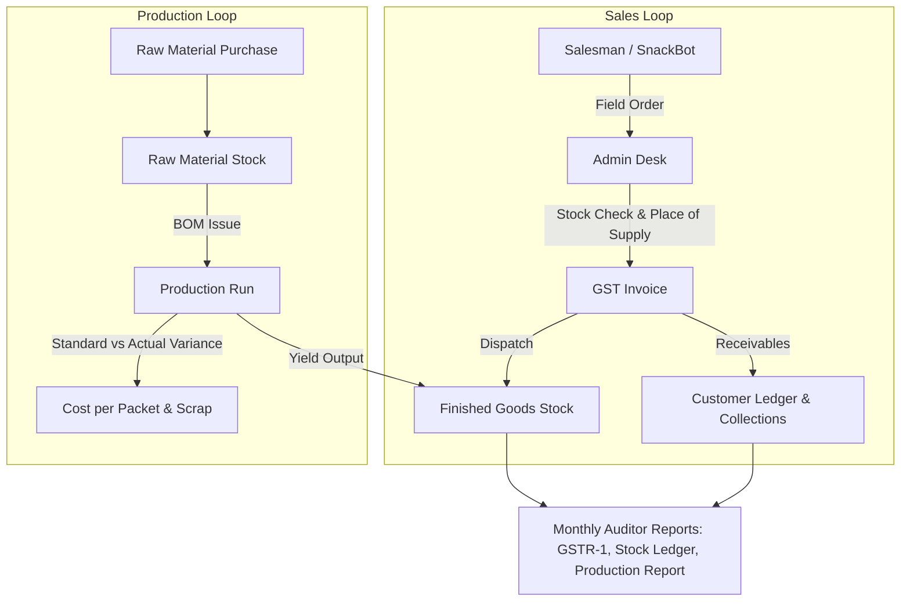
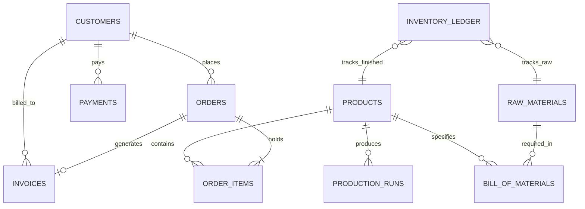

# Design Note: Order-to-Audit Architecture & Data Model
**Centre for Digital Infrastructure, NIT Tiruchirappalli**  
*System: Order-to-Audit System for a Small Food Manufacturer*

---

## 1. System Overview & Architecture Rationale
The application bridges the physical factory floor and external auditor desks via a **Unified Dual-Loop Architecture**:
1. **Sales Loop**: Field Order Capture (Mobile PWA & SnackBot WhatsApp/Telegram NLP agent) $\rightarrow$ Admin Stock Verification $\rightarrow$ GST Tax Invoice Generation $\rightarrow$ Warehouse Dispatch $\rightarrow$ Finished Goods Ledger Reduction $\rightarrow$ Receivables & Collections.
2. **Production Loop**: Raw Material Purchase & Inward $\rightarrow$ Bill of Materials (BOM) Standard Consumption Issue $\rightarrow$ Batch Production Floor Execution $\rightarrow$ Actual Yield & Scrap/Wastage Tracking $\rightarrow$ Finished Goods Ledger Increment $\rightarrow$ Cost Per Packet & Margin Analysis.

Both loops converge strictly at the **Finished Goods Inventory Ledger**, preventing stock mismatch between production records, billing desks, and auditor statements.

---

## 2. Entity-Relationship (ER) Data Model

### Key Tables & Invariant Design
- `inventory_ledger`: **Append-Only Immutable Ledger**. Current balance is never an overwritable column; it is always derived dynamically via:
  $$\text{Closing Stock} = \text{Opening Stock} + \sum \Delta \text{Inward} - \sum \Delta \text{Outward} \pm \text{Adjustments}$$
- `customers`: Holds state, GSTIN, and current outstanding balances.
- `invoices`: Stores intra-state (CGST + SGST) or inter-state (IGST) breakdowns with financial-year based sequence numbers (`INV/YYYY-YY/XXXX`).
- `production_runs`: Holds standard batch expectations, actual outputs, scrap, direct labour, and overhead allocations.
- `audit_logs`: Immutable trail of every creation, cancellation, or system event.

---

## 3. Inventory & BOM Consumption Mathematics

### 3.1 Unit Normalization & Precision
All monetary values are calculated in **integer-paisa equivalents** or strict two-decimal precision (`Math.round((val + EPSILON) * 100) / 100`) to guarantee zero floating-point accumulation drift across tax and stock calculations.

### 3.2 BOM Execution & Consumption Engine
For **Murukku 200 g**, 1 batch standard yield = 200 packets:
- Flour: 40 kg
- Cooking Oil: 10 L
- Salt & Spice Mix: 1.2 kg
- 200 g Pouches: 200 pieces
- Packing Cartons: 10 pieces (holds 20 pkts each)

When actual quantities differ:
$$\text{Yield Variance (\%)} = \frac{\text{Actual Output Packets} - \text{Expected Output Packets}}{\text{Expected Output Packets}} \times 100$$
$$\text{Oil Variance (\%)} = \frac{\text{Actual Oil Used} - \text{Standard Oil}}{\text{Standard Oil}} \times 100$$
Variances beyond $\pm 3\%$ are highlighted in alerts.

---

## 4. Costing & Valuation Methodology

### 4.1 Raw Material Inventory Valuation: Weighted Average Cost (WAC)
To reflect realistic commodity price fluctuations (e.g. Flour prices fluctuating from ₹42 to ₹45):
$$\text{New WAC} = \frac{(\text{Current Qty} \times \text{Old WAC}) + (\text{Purchased Qty} \times \text{Purchase Rate})}{\text{Current Qty} + \text{Purchased Qty}}$$
For the benchmark scenario:
- Opening Flour: 100 kg @ ₹42.00 = ₹4,200
- New Purchase: 60 kg @ ₹45.00 = ₹2,700
- Total: 160 kg = ₹6,900 $\rightarrow$ **WAC = ₹43.125 / kg**

### 4.2 Production Run Cost Breakdown (1 Batch producing 188 good packets):
1. **Flour**: $40\text{ kg} \times 43.125 = ₹1,725.00$
2. **Oil**: $10.5\text{ L} \times 140.00 = ₹1,470.00$
3. **Spice Mix**: $1.2\text{ kg} \times 200.00 = ₹240.00$
4. **Pouches**: $194\text{ pcs (188 used + 6 damaged)} \times 2.50 = ₹485.00$
5. **Cartons**: $9\text{ pcs} \times 15.00 = ₹135.00$
- **Total Direct Materials Cost**: ₹4,055.00

### 4.3 Overhead Allocation Rule
Direct Labour and Power/Overheads are allocated per run based on batch processing capacity:
- Direct Labour: ₹1,200.00
- Power & Gas Overheads: ₹600.00
- **Total Production Run Cost**: $4,055 + 1,200 + 600 = ₹5,855.00$

$$\text{Cost per Packet} = \frac{₹5,855.00}{188\text{ packets}} = \mathbf{₹31.14\text{ per packet}}$$

With a wholesale selling price of ₹50.00 per packet (before tax), the factory achieves a **37.7% gross margin**.

---

## 5. Auditor Reports & GST Returns Shape
- **Sales Register**: Customer name, GSTIN, place of supply, taxable value, CGST (2.5%), SGST (2.5%), IGST (5%), and invoice totals.
- **GSTR-1 Outward Supplies Matrix**: Mapped directly to B2B Table 4 for intra-state (TN) and inter-state (KA) transactions.
- **Stock Ledger**: Complete traceability from opening balance, purchase receipts, batch consumption, and dispatch deductions.
